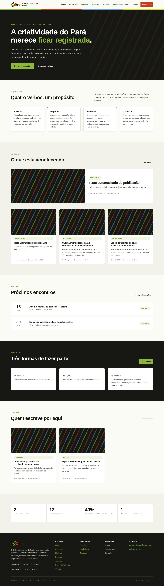
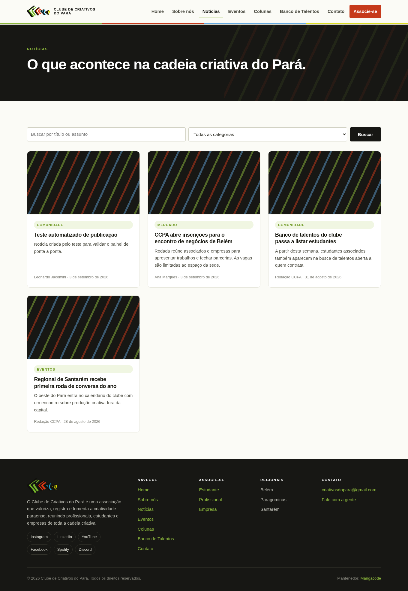
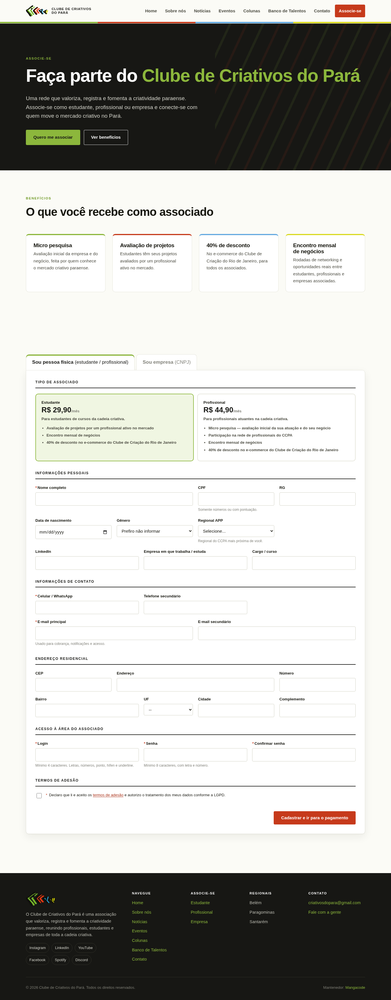
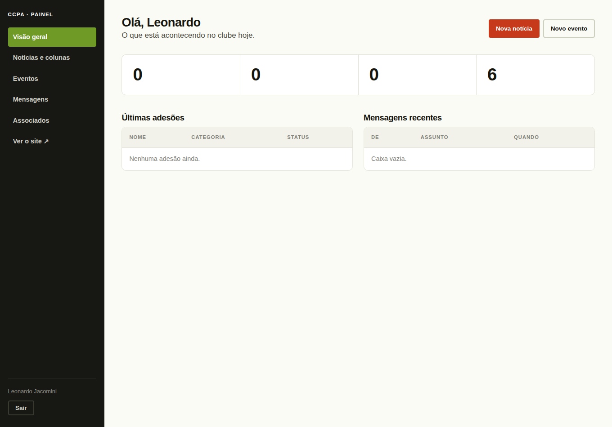
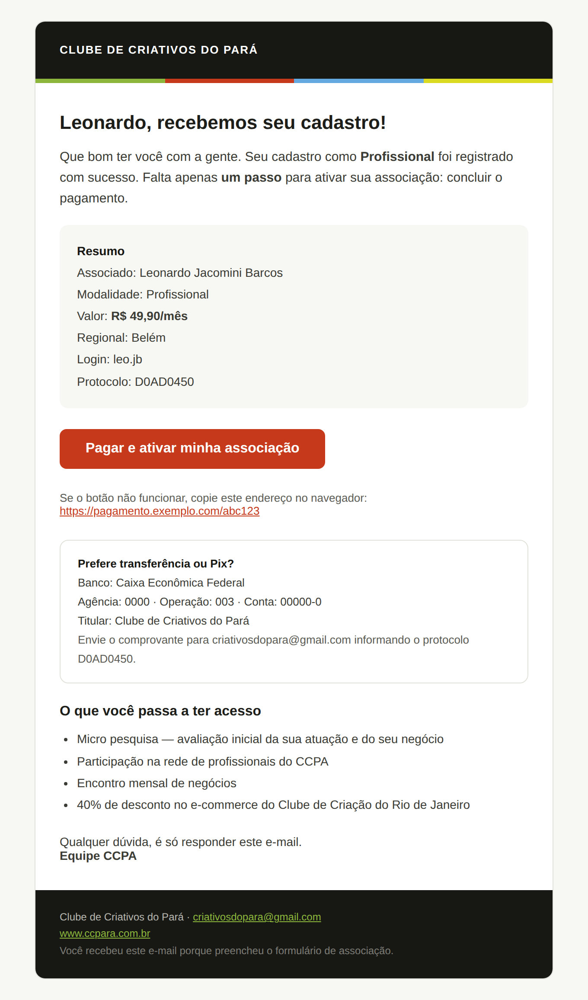

# CCPA Site — projeto de portfólio

[](LICENSE)

> [!IMPORTANT]
> **Este não é o site oficial do Clube de Criativos do Pará.** É um projeto de
> portfólio, *inspirado* no clube e publicado com autorização da diretoria. As
> notícias, colunas e eventos de demonstração são fictícios. O site oficial do
> clube é **[ccpara.com.br](https://www.ccpara.com.br)**.
>
> *This is not the official Clube de Criativos do Pará website. It is a
> portfolio project inspired by the club, published with its permission; the
> demo news, columns and events are fictional. The official site is
> [ccpara.com.br](https://www.ccpara.com.br).*

Institutional website and membership platform modelled on **Clube de
Criativos do Pará** (CCPA), a non-profit association of creative professionals
in the Brazilian state of Pará: home, about, news and columns, event calendar,
talent directory, contact form, membership signup with payment, and a
dashboard where the board publishes content without touching code.

**Stack:** Python · FastAPI · Jinja2 · SQLAlchemy 2 · Alembic · SQLite /
PostgreSQL · Resend (e-mail) · pytest · ruff. Out of the box it runs with a
simulated payment provider — no gateway account, no real money.

The membership system that grew out of this project lives in a separate
repository: [ccpa-associados-portfolio](https://github.com/Leonardo-Barcos/ccpa-associados-portfolio).

> The code and comments are in English; the interface is in Brazilian
> Portuguese, because that is what the site's visitors read.

<p align="center">
  
  
</p>

<p align="center">
  
  
  
</p>

---

## What it does

| Area | Path | Audience |
|---|---|---|
| Home, About, Contact | `/`, `/sobre`, `/contato` | Public |
| News and Columns | `/noticias`, `/colunas` | Public |
| Event calendar | `/eventos` | Public |
| Talent directory | `/talentos` | Public — fed by active members |
| Membership signup | `/associe-se` | Public |
| Publishing dashboard | `/admin` | Board, behind a login |

The talent directory has **no separate registration**: individual members whose
payment is up to date become searchable profiles. The page exposes name, role
and chapter only — e-mail, phone and documents never appear, and a test
enforces it.

### Plans

| Tier | Audience | Price |
|---|---|---|
| Estudante | Individual | R$ 29,90/month |
| Profissional | Individual | R$ 44,90/month |
| Empresa | Company | R$ 69,90/month |

---

## Why FastAPI, and what is interesting here

- **Every input is validated before it reaches the database.** Pydantic schemas
  cover CPF and CNPJ check digits, postal code, phone, password strength and
  the terms checkbox — see `app/validators.py` and `app/schemas.py`.
- **The payment layer is an abstraction, not a gateway client.** The app asks a
  `PaymentProvider` for a checkout link. Three implementations ship (mock,
  fixed link, Asaas); adding the bank's own API later means one new class and
  one environment variable. See `app/services/payments.py`.
- **The dashboard's text-to-HTML converter escapes before it converts.** A
  compromised admin account still cannot inject a `<script>` into the public
  site, which a general-purpose Markdown library would allow.
  See `text_to_html` in `app/services/content.py`.
- **The webhook is idempotent.** Gateways retry; a replayed event must not send
  the welcome e-mail twice.
- **Server-rendered HTML, no build step.** The JavaScript is vanilla and
  optional: input masks, tabs and postal-code lookup. The site works without it.

---

## Running locally

```bash
python3 -m venv .venv && source .venv/bin/activate
pip install -r requirements.txt
cp .env.example .env
python scripts/seed_demo.py     # optional: fictional demo content
python scripts/create_admin.py  # dashboard login
uvicorn app.main:app --reload
```

On Windows (PowerShell), without activating the virtualenv:

```powershell
python -m venv .venv
.\.venv\Scripts\python.exe -m pip install -r requirements.txt
copy .env.example .env
.\.venv\Scripts\python.exe -m uvicorn app.main:app --reload
```

Open <http://localhost:8000>. It runs fully with `PAYMENT_PROVIDER=mock`, so
the whole signup-to-activation flow can be demonstrated with no bank account.

`requirements.txt` covers development and production on SQLite. Install
`requirements-prod.txt` (PostgreSQL + gunicorn) on the server only — the
Postgres driver has no prebuilt wheel for every Python version and breaks local
installs for no reason.

---

## `check.py` — the missing build step

Python is not compiled, so nothing fails when the code is wrong: a bad import
or a `` in a template only surfaces when somebody opens the page.
`check.py` tries to break the application on purpose instead.

```bash
pip install -r requirements-dev.txt   # once
python check.py
```

Six stages, exit code 1 if any fails:

| # | Stage | What it catches |
|---|---|---|
| 1 | Dependencies | packages that conflict with each other (`pip check`) |
| 2 | Static analysis | undefined names, dead imports, unused variables, formatting (`ruff`) |
| 3 | Templates | Jinja syntax errors — every template is compiled, using the app's real environment |
| 4 | Configuration | a `Settings` field missing from `.env.example`; in production, a dev `SECRET_KEY`, `PAYMENT_PROVIDER=mock`, non-HTTPS `BASE_URL` or an empty Resend key |
| 5 | Tests | the 60 pytest cases |
| 6 | Smoke | starts the real app, hits every route, checks the assets exist and that `/admin` demands a login |

Autofix most of stage 2 with `ruff check --fix . && ruff format .`

**Running it automatically.** `python scripts/install_hook.py` installs a Git
pre-commit hook that aborts the commit on failure. GitHub Actions runs the same
script on Python 3.11, 3.12 and 3.13 for every push and pull request. On the
server, make it the last step before restarting: if it fails, the deploy stops
and the previous version stays up.

---

## Layout

```
app/
  main.py              FastAPI app, security headers, error handlers
  config.py            environment settings
  plans.py             >> PLAN CATALOGUE AND PRICES (edit here) <<
  site_content.py      >> INSTITUTIONAL COPY (edit here) <<
  models.py            members, payments, posts, events, messages, admin users
  schemas.py           validation for both signup forms
  validators.py        CPF, CNPJ, postal code, phone
  security.py          Argon2id, signed sessions, CSRF
  templating.py        Jinja environment and Brazilian date filters
  routers/
    site.py            public pages, robots.txt, sitemap.xml
    membership.py      signup forms and mock checkout
    admin.py           dashboard (login, CSRF, CRUD)
    webhooks.py        payment confirmation callback
  services/
    members.py         signup business rules
    content.py         editorial queries, slugs, text-to-HTML
    email.py           Resend
    payments.py        payment provider abstraction
  templates/           Jinja2 (site/, admin/, emails/)
  static/              CSS, JS, logo
tests/                 pytest
check.py               full pre-deploy verification
scripts/
  create_admin.py      create or reset a dashboard user
  seed_demo.py         fill the site with demo content
  preview_emails.py    render the e-mails to HTML without sending
  install_hook.py      install the Git pre-commit hook
```

---

## The signup flow

1. A visitor picks a tab (individual or company), a plan, and fills the form.
2. The server validates everything, stores the member as `AWAITING_PAYMENT` and
   records the consent trail (timestamp and IP, for Brazil's LGPD).
3. The payment layer opens a charge and returns a checkout link.
4. Resend delivers the welcome e-mail with the payment button, plus the bank
   details as a Pix/transfer alternative.
5. The gateway calls `POST /webhooks/pagamento` when the money arrives.
6. The member becomes `ACTIVE` and receives the confirmation e-mail.

---

## Configuration

### Resend

1. Verify the domain and add the SPF, DKIM and DMARC records. Without them the
   mail is delivered to spam — and the payment link is inside that mail.
2. Put the API key in `RESEND_API_KEY` and set `MAIL_FROM` to an address on the
   verified domain.

Every send is recorded in `email_logs` with the provider id or the error. A
failing mail provider never rolls back a completed signup.

### Payments

| Provider | When to use |
|---|---|
| `mock` | Development. Internal fake checkout, end-to-end. |
| `manual` | A fixed payment link from the bank's portal (`PAYMENT_STATIC_LINK`). |
| `asaas` | Recurring subscription (Pix, boleto or card), settling into the association's bank account. |

Point the gateway's webhook at `https://YOUR_DOMAIN/webhooks/pagamento`. The
route verifies the provider token and is idempotent.

---

## Security and privacy

- Passwords hashed with **Argon2id**, never logged, never e-mailed.
- Dashboard session in a signed, HttpOnly, SameSite=Lax cookie (12 h).
- CSRF token on every dashboard POST (double-submit, constant-time compare).
- Login failures return one generic message, so the form cannot enumerate accounts.
- CSP, `X-Frame-Options: DENY`, `nosniff`, HSTS in production.
- Rate limit of 120 requests/minute per IP.
- Consent stored with timestamp and IP; contact form protected by a honeypot.
- Secrets only in environment variables; `.env` is git-ignored.

Always run behind HTTPS — the forms carry passwords and national ID numbers.

---

## Deploying

```bash
gunicorn app.main:app -k uvicorn.workers.UvicornWorker -w 4 -b 0.0.0.0:8000
```

Use PostgreSQL (`DATABASE_URL=postgresql+psycopg://...`) and set
`APP_ENV=production`, which disables the interactive API docs and enables HSTS.
A `Dockerfile` is included.

---

## License

The **code** is MIT — see [LICENSE](LICENSE).

The **Clube de Criativos do Pará name, logo and visual identity** belong to
the club and are **not** covered by the MIT license. They are here, with the
club's permission, only so the portfolio shows the project as it was built. If
you reuse this code, replace them with your own (`app/site_content.py`,
`app/static/img/`).
